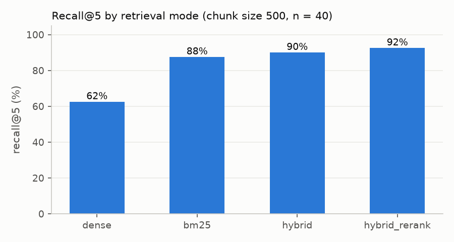

# Agentic RAG Assistant for Company Reports and Sales Data

> Status: **complete** (Stage 8 of 8). Built stage by stage; every number below
> was produced by the scripts in `eval/`.

An assistant that answers business questions from two sources and shows its work:

1. **Document RAG** over public company reports, with cited page numbers.
2. **Data agent** that answers questions about a retail sales table with safe, read-only SQL.
3. **Router agent (LangGraph)** that picks the right tool (documents, SQL, both, or refuse).

It runs entirely on a laptop with a free local model (Ollama, `qwen2.5:3b`), and it is
measured rather than demonstrated: 80 evaluation questions, each checked by hand before
use, and a failure log of every real bug found on the way (`docs/failure_log.md`).

**Measured on those 80 questions** (details and method in [Evaluation](#evaluation)):

| | |
|---|---|
| Right page found (hybrid search + reranking, top 5) | 92% |
| Document questions answered with the right number or name | 60% |
| SQL questions returning the right rows | 55% |
| Questions outside the data that were refused | 100% (10/10) |
| Time per answer (laptop CPU, 3B model) | about 2 minutes |

What those numbers are worth, and what I would fix first, is in
[Limitations](#limitations-and-what-i-would-do-next).

Architecture diagram and node-by-node walkthrough: [`docs/architecture.md`](docs/architecture.md).
Design decisions, with the reasoning behind each one: [`docs/decisions.md`](docs/decisions.md).

## Quickstart (development)

PowerShell (Windows):

```powershell
py -3.11 -m venv .venv
.\.venv\Scripts\Activate.ps1
python -m pip install --upgrade pip
pip install -e ".[dev]"
Copy-Item .env.example .env
python -m pytest
python -m ruff check .
```

bash (Linux/macOS):

```bash
python3.11 -m venv .venv
source .venv/bin/activate
python -m pip install --upgrade pip
pip install -e ".[dev]"
cp .env.example .env
python -m pytest
python -m ruff check .
```

Install every dependency group (needed from Stage 1 on): `pip install -e ".[all,dev]"`.

### Build the search indexes

Put the report PDFs in `data/raw/` (see `data/README.md`), then:

```
python -m assistant.ingest                     # chunk + embed + index (first run downloads the model)
python -m assistant.retrieval "What was Kering's revenue in 2025?"                 # hybrid + rerank
python -m assistant.retrieval "What was Kering's revenue in 2025?" --mode bm25     # dense | bm25 | hybrid | hybrid_rerank
python -m assistant.retrieval "What was Kering's revenue in 2025?" --compare       # all four modes side by side
```

### Ask questions (answers with cited pages)

The default LLM runs locally and for free with [Ollama](https://ollama.com):
install it, then `ollama pull qwen2.5:3b`. Set `LLM_PROVIDER` in `.env` to switch
(`ollama`, `groq`, `openai_compatible`, or `mock` for a fake LLM).

```
python -m assistant.ask "What was Kering's revenue in 2025?"
python -m assistant.ask            # interactive mode
```

### The full assistant (router agent)

```
python -m assistant.agent "What was Hermès' revenue in 2025?"
python -m assistant.agent            # interactive
```

The agent decides whether a question needs the reports, the sales data, both, or is out of
scope, and writes a JSON trace of every run to `logs/`. Architecture: `docs/architecture.md`.

### Sales data (text-to-SQL)

Download `online_retail_II.xlsx` (see `data/README.md`) into `data/raw/`, then:

```
python scripts/build_sales_db.py                                      # about a minute
python -m assistant.sql_ask "What was the total revenue in 2011?"
python -m assistant.sql_ask --sql "SELECT country, COUNT(*) FROM sales_clean GROUP BY country"
```

Every query passes a safety guard (single SELECT only, allowed tables only, enforced LIMIT,
read-only connection, time limit). Cleaning decisions: `docs/data_notes.md`.

Design choices are explained in `docs/decisions.md`.

### Troubleshooting (Windows)

`OSError: [WinError 1114] ... torch\lib\c10.dll`, or Python closing silently with exit code
`-1073741819` when importing `onnxruntime`: the virtual environment was created from an
**Anaconda** Python. Anaconda ships older copies of the Visual C++ runtime DLLs that recent
PyTorch and ONNX Runtime cannot use. Create the environment from the official python.org
installer instead (check with `python -c "import sys; print(sys.version)"`: it must not say
"Anaconda"), and install the CPU build of PyTorch first:

```powershell
& "$env:LOCALAPPDATA\Programs\Python\Python311\python.exe" -m venv .venv
.\.venv\Scripts\Activate.ps1
pip install torch --index-url https://download.pytorch.org/whl/cpu
pip install -e ".[all,dev]"
```

## Run it as a service

The same agent behind an HTTP API (FastAPI):

```powershell
uvicorn assistant.api:app --port 8000
```

Then open <http://localhost:8000/docs> for the interactive documentation, or:

```powershell
Invoke-RestMethod http://localhost:8000/health
Invoke-RestMethod -Method Post http://localhost:8000/ask -ContentType application/json `
  -Body '{"question": "What was Hermes revenue in 2025?"}' -TimeoutSec 600
```

`-TimeoutSec 600` matters: PowerShell gives up after 100 seconds by default, and a local
answer takes longer than that.

| route | what it does |
|---|---|
| `POST /ask` | one question; answers with the route taken, the answer, the cited pages, the SQL and its rows, the time per step and a trace id |
| `GET /health` | whether the assistant is ready, which LLM is configured, how many chunks are indexed; never calls the LLM |

The service answers **one question at a time** (a second question gets `429`): a local
model on a laptop CPU has no spare capacity, so serialising keeps latency predictable.
There is **no authentication and no rate limit**: it is meant to run on your own machine.

### Docker

```powershell
docker compose up --build        # http://localhost:8000/docs
```

The image contains the code only. The reports, the indexes and the sales database stay on
your machine and are mounted read-only, and Ollama keeps running on the host (the
container reaches it at `host.docker.internal`), so the model is not downloaded twice.
Build the indexes and the database before starting the container. The embedding and
reranking models (about 250 MB) are downloaded on the first question and kept in a volume.

To try the API shape without any model, start it with the fake LLM:

```powershell
$env:LLM_PROVIDER = "mock"; docker compose up --build
```

**Honest note:** the development laptop has no Docker engine, so the image has never been
run against the real indexes. It is built and started (with the fake LLM) by the `docker`
job of the CI workflow on every push, which is what verifies the `Dockerfile`. The
`uvicorn` command above is the path that was actually used to answer questions.

### Continuous integration

Every push runs `.github/workflows/ci.yml`, which has two jobs:

- **test**: ruff, the formatter check and the whole test suite on Python 3.11. The tests
  use a fake LLM, a fake embedder and a fake reranker, so this job needs no model, no
  network and no PyTorch (the `ci` extra), and finishes in about a minute.
- **docker**: builds the image and starts it with the fake LLM, then calls `/health`.
  Since CI has no indexes, the container answers "not ready": the job proves the image
  builds and serves HTTP, which is what the development machine cannot check.

## Evaluation

All numbers below are produced by scripts in `eval/` and saved in `results/`; nothing is
estimated. Only questions verified by hand are used (see `data/eval/`).

```
python -m eval.verify doc            # verify drafted questions (also: sql, mixed, oos)
python -m eval.run_all               # all steps; resumable (results/raw/ caches answers)
python -m eval.run_all --steps retrieval sql routing   # faster subsets
python -m eval.report                # rebuild the tables below from results/*.json
```

For the chunk-size ablation, build the extra indexes first:
`python -m assistant.ingest --chunk-size 300` and `python -m assistant.ingest --chunk-size 1000`.

<!-- RESULTS:START -->
Only questions verified by hand are used; unverified items are excluded.

| set | drafted | verified (used) |
|---|---|---|
| doc | 40 | 40 |
| sql | 20 | 20 |
| mixed | 10 | 10 |
| oos | 10 | 10 |

### Retrieval (40 verified document questions, page level)

| chunk size | mode | recall@3 | recall@5 | recall@10 | MRR | median latency |
|---|---|---|---|---|---|---|
| 300 | dense | 72% | 75% | 85% | 0.549 | 0.05 s |
| 300 | bm25 | 70% | 85% | 98% | 0.522 | 0.01 s |
| 300 | hybrid | 82% | 90% | 95% | 0.719 | 0.06 s |
| 300 | hybrid_rerank | 82% | 92% | 100% | 0.741 | 2.08 s |
| 500 | dense | 62% | 62% | 80% | 0.577 | 0.05 s |
| 500 | bm25 | 80% | 88% | 100% | 0.659 | 0.01 s |
| 500 | hybrid | 85% | 90% | 95% | 0.743 | 0.06 s |
| 500 | hybrid_rerank | 82% | 92% | 100% | 0.694 | 3.61 s |
| 1000 | dense | 62% | 62% | 78% | 0.577 | 0.05 s |
| 1000 | bm25 | 80% | 92% | 98% | 0.652 | 0.00 s |
| 1000 | hybrid | 82% | 85% | 95% | 0.710 | 0.05 s |
| 1000 | hybrid_rerank | 85% | 98% | 98% | 0.757 | 3.58 s |



### Text-to-SQL (20 verified questions, ollama:qwen2.5:3b)

| max retries | retry on empty result | execution accuracy | query ran | guard rejections (share of attempts) | questions with a retry | median latency |
|---|---|---|---|---|---|---|
| 2 | no | 55% | 100% | 0% | 0 | 11.16 s |
| 0 | no | 55% | 100% | 0% | 0 | 10.93 s |
| 2 | yes | 55% | 100% | 0% | 2 | 11.23 s |

The first two rows are the baseline. Retry-on-empty-result (last row) was added after looking at the baseline failures, on the same questions, so its gain is optimistic: there is no separate held-out set.

### Routing (80 verified questions, ollama:qwen2.5:3b)

Overall accuracy: **75%** (unparseable router replies: 0).

| expected route | n | accuracy |
|---|---|---|
| documents | 40 | 70% |
| sales_data | 20 | 75% |
| both | 10 | 100% |
| out_of_scope | 10 | 70% |

### End-to-end answers (verified questions, ollama:qwen2.5:3b)

| metric | n | value |
|---|---|---|
| Document questions: gold number/name in the answer | 40 | 60% |
| Document questions: cites a gold page | 40 | 57% |
| Document questions: answered "not found" | 40 | 5% |
| Mixed questions: routed to both | 10 | 100% |
| Mixed questions: reports part correct | 10 | 80% |
| Mixed questions: SQL part correct | 10 | 70% |
| Out-of-scope questions: refused | 10 | 100% |
| LLM judge: correct (answered questions) | 35 | 63% |
| LLM judge: faithful to cited pages | 35 | 54% |

The LLM judge is the same small local model as the system; it is imperfect (it can be lenient or misread numbers). Hand check of 20 judgements: agreement 80% (correctness 90%, faithfulness 70%).

#### Latency per route (laptop CPU, local LLM)

| route | n | median | p95 |
|---|---|---|---|
| both | 19 | 133.2 s | 180.85 s |
| documents | 31 | 117.61 s | 155.32 s |
| out_of_scope | 9 | 3.48 s | 4.26 s |
| sales_data | 1 | 25.41 s | 25.41 s |

Tokens per query (input + output, all LLM calls): median 2929.0, mean 2697.6 (n = 60).

First run, before the split-validation fix (ollama:qwen2.5:3b, same questions): document answers 52%, mixed reports part 80%, mixed SQL part 70%, out-of-scope refusals 100%. The fix drops sub-questions that the split model invents (see docs/decisions.md); it was written after reading the first run's traces, so only the questions routed to `both` were re-run.
<!-- RESULTS:END -->


## Project layout

```
src/assistant/
  ingest/      PDF -> text blocks -> chunks -> Chroma (dense) + BM25 (keywords)
  retrieval/   the four search modes: dense, bm25, hybrid (RRF), hybrid + reranking
  tools/       doc_search (answer with citations), sql_guard (safety), sql_tool
  agent/       the LangGraph graph (route -> split -> doc_rag / sql_agent -> synthesize)
  llm.py       one interface, four providers (mock, Ollama, Groq, OpenAI-compatible)
  api.py       FastAPI service
eval/          the measuring scripts; report.py writes the tables in this README
data/eval/     the 80 evaluation questions, each marked verified by hand
docs/          architecture, decisions, failure log, data notes, sample traces
tests/         172 tests; no model, no network
```

## Limitations and what I would do next

**What the numbers do not say.** Each set is small: 40 document questions, 20 SQL, 10
mixed, 10 out of scope. One document question is worth 2.5 points, so a 2-point difference
is noise. The same question can also give a different answer on two runs (one mixed
question flipped between the two agent runs), because the model is generating text, not
looking up a table. Treat every figure as "about", not "exactly".

**Where the errors actually come from.** Retrieval finds a correct page for 92% of the
document questions, but only 60% of the answers carry the right number. Reading the wrong
cell of a dense financial table is the single biggest error source: the 2023 column
instead of 2025, the parent company instead of the group, another company's figure. The
same weakness explains the 55% on SQL: the rules it needs are written in the schema notes,
and a 3B model does not apply them reliably.

**The faithfulness numbers are the least reliable.** The LLM judge agreed with my own
reading on 90% of correctness decisions but only 70% of faithfulness ones (20 judgements
checked by hand). Read "faithful to cited pages" as an indication, not a measurement.

**Scope.** Three reports, one sector, one year; the sales data stops in December 2011, so
"what is happening now" has no meaning here. Tables are read as flattened text, not as
tables. Charts and images in the PDFs are ignored. The API has no authentication and no
rate limit and answers one question at a time; the Docker image is built in CI but has
never been run against the real indexes.

**What I would do next, in order of expected gain:**

1. **A larger answering model.** Most remaining errors are reading errors, not retrieval
   errors. The same pipeline with a 7-8B model (or a free hosted tier) should move the
   answer accuracy well before any further tuning of the retrieval does.
2. **Table-aware extraction.** Parsing the financial tables into rows and columns, instead
   of flattening them into a paragraph, attacks the biggest error class directly.
3. **Check the answer against its citation at answer time.** The evaluation already
   measures whether a number appears on the cited page; doing the same check in the
   pipeline would let the assistant say "I am not sure" instead of stating a wrong figure.
4. **A cheap router before the LLM.** Three valid questions out of 80 were refused as out
   of scope. Simple rules ("gift shop", "revenue in 2011") would catch those for free.
5. **Bigger evaluation sets and repeated runs**, to replace single numbers with ranges.

## License

MIT. See `LICENSE`. Data sources and their licenses are listed in `data/README.md`.
