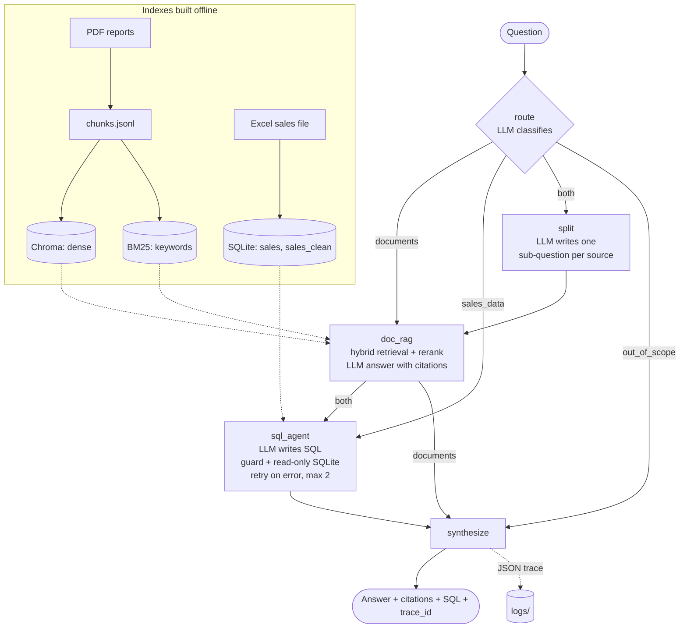

# Architecture

## How it works

1. **Offline**: the PDFs are split into passages of at most 500 tokens, indexed twice
   (embeddings in Chroma, keywords in BM25). The Excel sales file is cleaned into SQLite.
2. **route**: the LLM classifies the question into one of four labels. If its reply has no
   valid label, the agent falls back to `both` (searching both sources is safer than
   refusing a valid question).
3. **doc_rag**: dense + BM25 results are fused (RRF, k = 60) and reranked by a
   cross-encoder; the top 5 passages go to the LLM, which must cite them.
4. **sql_agent**: the LLM writes one SELECT; the guard validates it; SQLite runs it
   read-only with a time limit; errors are fed back for up to 2 retries.
5. **split** (only for `both`): the LLM rewrites the question as one sub-question per
   source, so each tool receives a question it can fully answer.
6. **synthesize** (no LLM): single-source answers are returned as they are; `both` places
   the two answers side by side with a fixed template; `out_of_scope` returns a fixed
   refusal.
7. **trace**: every node records its latency, inputs, outputs and token counts; the run is
   saved as JSON in `logs/` (examples in `docs/sample_traces/`).
